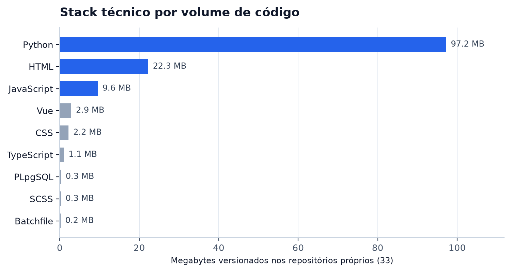

# Projetos — detalhamento técnico

Portfólio completo da **DJT Sistemas**: 33 repositórios próprios (2 públicos, 31 de cliente com acesso restrito), 1.359 commits e ~299 MB versionados.

**Como ler este documento:** os repositórios de cliente mantêm o conteúdo sob reserva comercial; descrevo aqui **o que cada sistema faz, o que integra e quais dados ele gera e controla** — telas, repositórios e referências são apresentados mediante solicitação. Têm nome explícito aqui os contratos autorizados para divulgação: **Móveis Weihermann S.A.**, **Lagom**, **Tintas MC** e **Revest**. Demais clientes permanecem descritos por segmento.

---

## 1. BI e gestão — SIG

### `sig` — Sistema de Informações Gerenciais · **Móveis Weihermann S.A.** *(473 commits, 17,5 MB)*
Sistema que extrai e consolida a informação do **ERP FOCCO** em PostgreSQL e a devolve como gestão — sustenta o suporte interno ao ERP, os **fechamentos de custos contábeis e de estoques** e a **programação de produção do PCP** alinhada ao Comercial.

- **Domínios:** `financeiro_app`, `comercial_app`, `compras_app`, `estoques_app`, `pcp_app`, `projetos_app`, `cadastros_app` + `shared_core` de contratos comuns.
- **Regra de arquitetura:** a integração FOCCO → PostgreSQL vive exclusivamente em um serviço **Go** dedicado; nenhuma refatoração de domínio pode movê-la para Flask/Python.
- **Dados controlados:** títulos a receber (`ttit_cr`), histórico de movimentações (`thist_mov_cr`), lançamentos e contas contábeis (`tlcto_ctab`, `temp_cta_ctab`), estabelecimentos, clientes, bancos e agências, tipos de NF, mercados, almoxarifados, cidades/UFs/países/idiomas/moedas. 51+ tabelas só no schema financeiro; 547 scripts SQL.
- **Refatoração faseada:** monolito de bootstrap dividido por domínio **sem alterar nenhuma URL** em produção.
- **IA sobre o ERP:** servidor MCP com catálogo semântico de ferramentas gerado do contrato real, seletor determinístico (máximo de 6 ferramentas por chamada), decisões seguras antes de invocar o modelo, sanitização de argumentos por palavra inteira, guarda de SQL, provedores Ollama/OpenAI/Anthropic, painel administrativo de telemetria e benchmarks, avaliador com dataset de 50 perguntas e fixtures.
- **Segurança operacional:** autenticação por Bearer, escopo de empresa por cadeia de vínculo, rotação de credencial que havia ficado no histórico do git, ponto de backup antes de cada reset de conciliação.

### `gis-financeiro` — Financeiro, DRE e fluxo de caixa *(112 commits)*
Geração anterior do SIG: controle de fluxo de caixa, DRE, contas a pagar e receber, relatórios consolidados multiempresa, regionais e mensais, com importadores auditados de bancos, agências e tipos de NF.

### `sig-revest` / `revest_sig` / `revest-sig` — SIG da **Revest** + DataLake *(240 commits)*
Instância independente do SIG para a **Revest**, com as integrações migradas de FOCCO para **DevCo/iDempiere**, evoluindo para uma base com DataLake:

- **7 pipelines de importação medidos lado a lado** (`c_bpartner`, `m_product`): dbt (raw JSONB → staging → marts incrementais), MongoDB com upsert em lote, Pandas com `COPY` comparado a `to_sql(method="multi")`, Spring Batch para PostgreSQL (JDBC batch upsert) e para MongoDB (bulk upsert), Apache NiFi com `MERGE`/`ON CONFLICT` e `PutMongoRecord`.
- **Stack observável:** PostgreSQL, MongoDB, Prometheus, postgres-exporter, mongodb-exporter, node-exporter e cAdvisor em Docker Compose próprio, com volumes, redes e schemas prefixados — leitura somente `GET` no ERP, nenhuma escrita.
- **Frontend "Performance de Dados"** em Vue 3 + TypeScript + PrimeVue com API de leitura em FastAPI para comparar os mesmos dados em PostgreSQL e MongoDB.

### `fazendao-sig` — Informações executivas e conciliação bancária *(8 commits, projeto novo)*
Plataforma de conciliação bancária e auditoria financeira de rede de material de construção contra o **Viasoft Construshow**:

- Concilia lançamentos de vários bancos com os títulos do ERP e **libera o pedido somente após confirmação de PIX no extrato**.
- Audita pagamentos e folha com trilha de evidência; **acrescentar banco é configuração** (catálogo de conectores e perfis de arquivo em YAML).
- Backend Go 1.23 (chi, pgx/sqlc, goose, River), PostgreSQL 16 + pgvector, frontend Vue 3 + PrimeVue isolado, **MCP Server** expondo tudo a agentes de IA com aprovação humana em toda escrita, segredos no Infisical, Docker Compose + Caddy em VPS.
- Documentação de projeto: plano técnico, brief de construção, fases, ADRs, guia de fluxo de git, catálogo de bancos e memória curada de precedentes.

---

## 2. Integrações ERP — middlewares

### `revest_middleware` — Middleware de integração entre sistemas · **Revest** *(266 commits, 35,6 MB)*
Escopo autorizado: **middleware entre o ERP DevCo, o WMS, as APIs bancárias e a automação das notas de transferência entre filiais**. Especificação por módulo (setup, shell, auth, admin, configurações, DevCo, Lagom, PDV) com skills de **preservação de contrato** e **planejamento de migração WMS**. Flask + SQLAlchemy + Marshmallow + Flasgger (Swagger), Pandas/openpyxl para carga de contas a pagar e condições de pagamento, PostgreSQL, Docker.

### `revest_wms_trial` — Pilote de migração para WMS *(26 commits)*
Cliente/serviço DevCo com validação de contrato, plano de migração versionado, relatório de auditoria em checklist e coleção Postman de aceitação.

### `lagom_*` — DRP **Lagom** ↔ ERP dos clientes da Lagom *(83 commits no conjunto)*
A **Lagom** (software house de Curitiba/PR) vende um DRP de otimização de estoques; a DJT faz a ponte entre o DRP e o ERP de cada cliente dela — **Citel, Flex, Bling e Viasoft**. Mesma base Flask reutilizada:

| Repositório | Par integrado | O que faz |
|---|---|---|
| `lagom_revest` | Lagom ↔ DevCo | Transferências entre depósitos, agrupamento por destino, conferência de status de pedidos, relatório de cancelamento |
| `lagom_acefer` | Lagom ↔ Citel | Baixa de pedidos, log de retorno GIX, monitoramento de jobs |
| `lagom_biadola` | Lagom ↔ Citel | Cadastros e baixa de pedidos com log de retorno |
| `lagom_sotintas` | Lagom ↔ ERP do cliente | Pedidos, cadastros e queries de conciliação |
| `lagom_gasparetto` | Lagom ↔ ERP do cliente | Cadastros e movimentações de pedido |
| `lagom_viasoft` / `lagom_fazenda` | Lagom ↔ Viasoft Construshow | Primeiras rotinas de integração entre DRP e ERP |
| [`lagom_bling`](https://github.com/danielfourmanute/lagom_bling) | Lagom ↔ Bling API v3 | **Público** — base auditável: Fastify read-only, contratos de domínio, chave de idempotência, máquina de estados, Prisma + migrations, Vue 3/PrimeVue, escrita desligada por padrão |

### `tintasmc` / `lagon_tintasmc` / `tintasmc-middleware` — Middleware **VTEX ↔ GIX** da **Tintas MC** *(77 commits no conjunto)*
Escopo autorizado: **middleware entre a plataforma VTEX (e-commerce) e o ERP GIX** da Tintas MC, maior distribuidora Suvinil do Brasil. Monorepo `uv` com `apps/api` (FastAPI) e `apps/web` (Vue/Sakai), workers de sincronização de catálogo, coleção Postman, documentação de pré-requisitos para reativação de jobs e **agentes de IA de projeto** definidos em `.claude/agents` (integrador backend, arquiteto frontend, observabilidade PostgreSQL, arquiteto de solução).

### `revest-middleware-old` — Primeira geração em Go *(2 commits)*
Back-end **Go** com front-end Vue/Vite e PostgreSQL, e biblioteca de skills de UI (PrimeVue: botão, gráfico, tabela, formulário) reutilizadas nos projetos seguintes.

---

## 3. Fiscal, financeiro e produção

| Repositório | O que faz | Dados gerados e controlados | Stack |
|---|---|---|---|
| `monitor_credito_assistido` *(37 commits)* | MVP **multi-tenant** de controle de crédito assistido de impostos da reforma fiscal | Créditos **IBS/CBS** por empresa/tenant, lotes de ingestão, trilha de resiliência de workers | FastAPI, SQLAlchemy + Alembic, OIDC com PKCE, Redis, diagramas Mermaid de sequência |
| `enthus_funrural` *(8 commits)* | Análise de **Notas de Produtor Rural** | NPR, apuração fiscal do produtor, documentos e bases de referência | Flask + migrações, front-end com grade de dados |
| `faz_predify` *(9 commits)* | Rotinas e views SQL de vendas | `UV_PREDIFY_VENDAS_OFI_DIARIA/TOTAL`, `UV_TRANSFERS`, ajuste de preço | PL/SQL |
| `cmaq` *(indústria moveleira)* | Carga de máquina e gestão de produção | Ordens de produção pai/filho, roteiro por máquina, demanda, máscara, plano mestre, **rede PERT/CPM**, lotação | Flask + FastAPI, PostgreSQL pgvector, Qdrant, Pandas |
| `v4-flexivel` | Controle de tanques | Níveis e movimentação de tanques | reservado |
| `fazendao_roomvo` | Integração com ambiente de renderização de móveis | Projetos, imagens e extração de cor/tom ligada ao **Oracle** do ERP | FastAPI, `oracledb`, túnel SSH, scikit-learn, colorthief |
| `fazendao_integracao` | **Product matching** entre sistemas distintos | Pares de produtos e similaridade por embeddings | FastAPI, PostgreSQL pgvector |
| `viaflix` / `viaflix-old` | Gestão e controle para e-commerce | Pedidos de marketplace (Shopee), tabela de custos, análise de margem, integrações AWS/BigQuery/Google Sheets | Python |

---

## 4. Camada de IA aplicada a sistemas de gestão

É o fio condutor dos projetos mais recentes — e o que mais diferencia este portfólio:

- **Servidor MCP sobre o ERP** em três frentes: SIG (consulta administrativa com escopo por empresa), sistema de conciliação executiva (leitura livre, **escrita só com aprovação humana**) e catálogo de ferramentas versionado.
- **Método mensurável, não opinião:** catálogo de ferramentas gerado do contrato real do MCP, seletor determinístico de capacidades, dataset de avaliação com 50 perguntas e fixtures simuladas, pontuação por cenário, benchmarks por modelo e por horário de pico, generalização medida em conjunto separado.
- **Guardas antes do modelo:** classificação de decisão ambígua, somente leitura, sensível ou não suportada; sanitização de argumentos exigindo palavra inteira (um teste de benchmark mostrou que `empresa=1` era aceita por substring dentro de `45210`).
- **Documentação de agentes por projeto:** comandos e regras para agentes em `.claude/commands`, `AGENTS.md`, memória e specs de telas.

---

## 5. Métricas

O volume total medido pelo GitHub Linguist é 155,7 MB; os 298,9 MB incluem arquivos não atribuídos a linguagem (dados, imagens, artefatos).

| Métrica | Valor |
|---|---|
| Repositórios próprios (forks excluídos) | 33 |
| Commits no branch padrão | 1.359 |
| Volume versionado | 298,9 MB |
| Python | 97,2 MB — 62,4% do volume de código medido; linguagem principal em 23 dos 33 repositórios |
| Camada de interface (HTML/JS/Vue/TS/CSS/SCSS) | 56,0 MB — 36,0% do volume de código medido |
| Arquivos `.py` só no SIG | 1.200 |
| Arquivos `.sql` só no SIG | 547 |
| Anos com atividade versionada | 2024, 2025, 2026 |

Os números são reproduzíveis por [`tools/coleta-github.py`](tools/coleta-github.py) a partir de [`dados/github-stats.json`](dados/github-stats.json). Forks de estudo (Dexo, usd-brep, net-inventory-ia, 500-AI-Agents-Projects) são excluídos de todas as contagens.

---

## 6. O que não está no GitHub (e não entra nas métricas)

Boa parte do meu trabalho não é código versionável, e prefiro não inflar números com ele:

- **Suporte interno ao ERP FOCCO** na Móveis Weihermann S.A.: sustentação de rotinas, correções e acompanhamento da base em produção.
- **Fechamentos de custos contábeis e de estoques** mensais, com validação de movimentação e tratativa de divergência antes do fechamento.
- **Coordenação do PCP** — programação de produção alinhada com o Comercial (capacidade, demanda, ordens de produção).
- **Contratação e gestão de terceiros** para infraestrutura interna e manutenção do parque de máquinas.
- **Sistema de apontamentos de OEE** (Vieli Consultoria Industrial): primeira versão da solução, com leitura em tempo real de parada de máquina e produção (ML, M2 e contadores) a partir de **CLPs WEG PL300, Panasonic, Siemens e Raspberry Pi** via **Modbus**, **sensores industriais** (encoder, sensor indutivo), programação básica nos CLPs, **C++ e Python sobre MySQL**, e instalação/comissionamento em campo em clientes de diversos portes, como **Herval, Zozzoli S.A. (Argentina) e Temasa**.
- **Gestão de pessoas e carteira** (Viasoft, Unidade Indústria, 2011-2013) e o **desenvolvimento do ERP da Hightech Sistemas** como sócio-gerente (1998-2010).
- Levantamento de requisito, treinamento de usuários e sustentação em ambiente de cliente.

---

Voltar para o currículo → [README](README.md)
