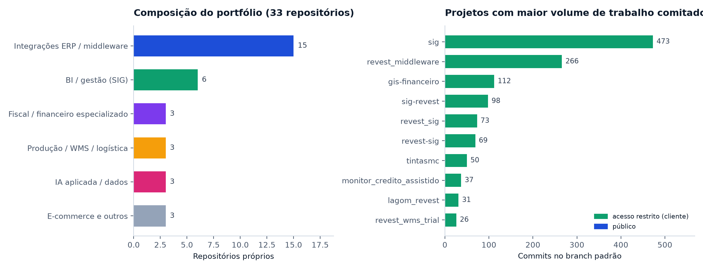
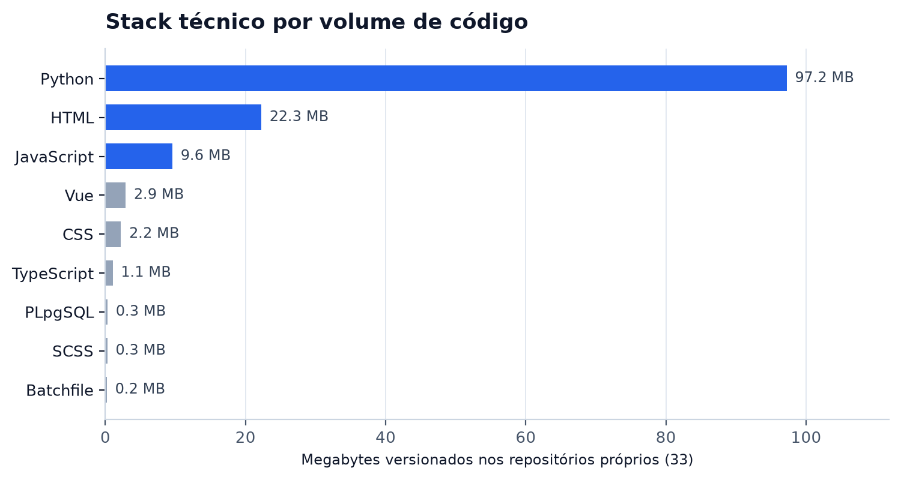

# Daniel Fendrich

**Analista de Sistemas — ERP, PCP e Custos, Integrações Industriais, Dados e IA aplicada à gestão**

<p>
  <a href="https://github.com/danielfourmanute"></a>
  
  
  
  
</p>

> **Este repositório é o meu currículo vivo.** Toda afirmação técnica desta página aponta para um repositório e para o código que o sustenta — quase todo ele em produção, em ambiente de cliente.

📄 **PDF para envio (2 páginas):** [`Curriculo-Daniel-Fendrich.pdf`](Curriculo-Daniel-Fendrich.pdf) · 📚 **Detalhamento por projeto:** [`PROJETOS.md`](PROJETOS.md)

---

## Resumo

Analista de sistemas com trajetória iniciada em 1994: programador desde 2001, **sócio-gerente da Hightech Sistemas (1998-2010) responsável pelo desenvolvimento do ERP** da casa, **Gestor da Unidade Indústria da Viasoft (2011-2013)** em Pato Branco/PR — liderando programadores, consultores e suporte sobre uma carteira de clientes industriais de vários segmentos — e, desde 01/08/2019, proprietário da **DJT Sistemas**, atividade exercida em paralelo ao vínculo CLT.

O meu eixo é sempre o mesmo: **fazer o sistema de informação refletir a operação real**. Isso me levou do chão de fábrica (leitura de CLP, sensores e contadores para OEE em tempo real) ao fechamento contábil de custos e estoques, da programação de produção alinhada ao Comercial às integrações entre DRP, e-commerce, ERP e APIs bancárias — e hoje à camada de IA que consulta esse patrimônio de dados com segurança.

Trabalho de forma intensiva com **ferramentas de IA no ciclo de entrega** (Claude Code, Codex e Gemini, com GitHub e VS Code), mantendo especificação, decisões de arquitetura e documentação versionadas junto do código para que a aceleração não vira passivo técnico.

| | |
|---|---|
| **Núcleo técnico** | Python (Flask, FastAPI, SQLAlchemy), Go, Node/TypeScript, C++, PostgreSQL, MongoDB, Redis |
| **ERP e domínio** | Suporte interno ao ERP FOCCO, fechamento de custos contábeis e de estoques, PCP e programação de produção, compras, estoque, DRE e fluxo de caixa |
| **Integrações** | APIs REST (FOCCO ERP, bancárias), DRP Lagom ↔ ERPs (Citel, Flex, Bling, Viasoft), VTEX ↔ GIX, DevCo ↔ WMS, notas de transferência entre filiais |
| **Industrial** | CLPs WEG PL300, Panasonic, Siemens e Raspberry Pi, protocolo Modbus, encoder e sensor indutivo, C++ e MySQL, instalação em campo |
| **Dados e IA** | dbt, Apache NiFi, Spring Batch, pgvector, servidor MCP com catálogo de ferramentas, avaliação com dataset e telemetria |
| **Gestão** | Coordenação de PCP com o Comercial, contratação e gestão de terceiros (infraestrutura interna e manutenção do parque de máquinas), liderança de equipe de desenvolvimento |



---

## Experiência

### Móveis Weihermann S.A. — sistemas, PCP e custos
**atuação via DJT Sistemas · em aberto** · São Bento do Sul/SC

Atendimento de ponta a ponta da operação de informação da indústria moveleira:

- **Responsável pelo suporte interno do ERP FOCCO** — sustentação, correções, ajustes de rotinas e acompanhamento da base em produção.
- **Fechamentos de custos contábeis e de estoques** mensais, com validação de movimentação e rastre de divergência antes do fechamento.
- **Coordenação das atividades do PCP**: programação de produção alinhada com o Comercial, com capacidade, demanda e ordens de produção.
- **Contratação e gestão de terceiros** para o controle da infraestrutura interna e a manutenção do parque de máquinas.
- **Criação e proposição de soluções de melhoria e automação de processos** — do levantamento de requisito à entrega em produção.
- Entrega assistida por IA (**Claude Code, Codex, Gemini** com GitHub e VS Code) sobre o **SIG** que consolida as informações extraídas do ERP: ~1.200 arquivos Python, 547 scripts SQL, 473 commits e 51+ tabelas no schema financeiro.
- **Stack em uso direto:** PostgreSQL, MongoDB e Redis; APIs REST do FOCCO ERP e APIs bancárias.

### DJT Sistemas — proprietário e consultor de TI
**01/08/2019 – em aberto** · São Bento do Sul/SC · *em paralelo às atividades CLT*

Serviços de **integração de software** entre plataformas de parceiros e os ERPs dos clientes deles:

| Plataforma atendida | O que a plataforma faz | O que a DJT entrega |
|---|---|---|
| **LAGOM** (software house de Curitiba/PR) | DRP para otimização de estoques | Integração entre o DRP e os **ERPs dos clientes da Lagom** — Citel, Flex, Bling e Viasoft; baixa de pedidos, transferências e monitoramento dos jobs |
| **TINTAS MC** | Maior distribuidora Suvinil do Brasil; e-commerce em VTEX | **Middleware entre VTEX e o ERP GIX**, com sincronização de catálogo e escrita controlada |
| **REVEST** | Indústria com ERP DevCo e operação de armazenagem | **Middleware DevCo ↔ WMS**, **APIs bancárias** e **automação das notas de transferência entre filiais** |

- Arquitetura modular por domínio (financeiro, comercial, compras, estoques, PCP, projetos, cadastros) com `shared_core` de contratos, migrada de um monolito de bootstrap **sem alterar nenhuma URL de produção**.
- Camada de IA consultável sobre o ERP: servidor MCP com catálogo de ferramentas gerado do contrato real, seletor determinístico de capacidades, guarda de SQL, sanitização de argumentos, painel de telemetria, avaliador com dataset de 50 perguntas, recall 39/39 na seleção de ferramentas e benchmarks por modelo e por horário.
- Decisão de stack por medição: 7 pipelines de importação (dbt, Pandas, MongoDB, Spring Batch, Apache NiFi) comparados com Prometheus/Grafana em ambiente observável isolado.
- 33 repositórios próprios e 1.359 commits versionados, com especificação, ADRs, migrations, testes e documentação de implantação e rollback.

### Vieli Consultoria Industrial Ltda — Analista de Desenvolvimento de Sistemas
**11/2017 – em aberto (CLT)** · São Bento do Sul/SC · CBO 212405

- **Responsável pela primeira versão do sistema de controle de apontamentos de OEE**: leitura em tempo real da parada de máquina, produção (ML, M2 e contadores) e estado por equipamento.
- Conexão direta com **CLPs WEG PL300, Panasonic, Siemens e Raspberry Pi** pelo protocolo **Modbus**, com programação básica nos CLPs e integração de **sensores industriais** (encoder, sensor indutivo).
- Desenvolvimento em **C++ e Python** sobre **MySQL**; instalação e comissionamento dos equipamentos **em campo**.
- Atendimento a clientes de diversos portes: **Herval, Zozzoli S.A. (Argentina), Temasa**, entre outros.

### Viasoft — Gestor da Unidade Indústria
**2011 – 2013** · Pato Branco/PR

- Responsável pela **carteira de clientes indústria**: gestão de **programadores, consultores e suporte**, com escopo, prazos e qualidade de entrega sobre clientes de diversos segmentos e portes.
- Visão de produto ERP pela ótica do cliente industrial — base que hoje aplica no suporte interno ao FOCCO e nas integrações entre plataformas.

### Hightech Sistemas — sócio-gerente
**1998 – 2010**

- **Sócio-gerente responsável pelo desenvolvimento do ERP** da empresa: ciclo completo de análise, desenvolvimento, implantação e sustentação.

### AMC Prestadora de Serviços Ltda — Programador de Computador
**08/2001 – 06/2002** · São Bento do Sul/SC · CBO 8420

- Programação de sistemas corporativos; primeiro registro formal na função de programador.

### Início de carreira
**1994 – 1995** · São Bento do Sul/SC

- Operador de máquinas de processamento de dados na **Muricy Infor** (treinamento, desenvolvimento e assessoria em informática) e rotinas administrativas — primeiro contato profissional com sistema de informação.

---

## Stack com evidência



| Tecnologia | Onde foi usada |
|---|---|
| **Python** (Flask, FastAPI, SQLAlchemy, Alembic, Pandas) | Núcleo de 25 dos 33 repositórios: SIG, middlewares de integração, painéis e rotinas de importação |
| **Go** (chi, pgx/sqlc, goose, River) | Camada de integração FOCCO → PostgreSQL e a API/worker do sistema de conciliação executiva |
| **C++ / Python industrial** | Aquisição de dados de CLP (Modbus), sensores e contadores para OEE em tempo real |
| **PostgreSQL** (+ pgvector, PL/pgSQL) | Base consolidada de todos os sistemas; vetores para matching de produtos e busca semântica |
| **MongoDB · Redis** | Armazenamento alternativo nos pipelines medidos; filas, cache e OIDC/PKCE no controle de crédito IBS/CBS |
| **MySQL** | Base do sistema de apontamentos de OEE em ambiente industrial |
| **dbt · Apache NiFi · Spring Batch** | Pipelines de carga comparados em ambiente observável (Prometheus/Grafana/cAdvisor) |
| **Vue 3 · PrimeVue · TypeScript · Fastify · Prisma** | Painéis operacionais, console administrativo e middleware público de integração com o Bling |
| **CLP e IIoT** | WEG PL300, Panasonic, Siemens, Raspberry Pi; Modbus; encoder e sensor indutivo; instalação em campo |
| **IA no ciclo de entrega** | Claude Code, Codex e Gemini com GitHub e VS Code; comandos, agentes e memória de projeto versionados nos repositórios |
| **Infra e método** | Docker Compose, Caddy em VPS, GitHub Actions, especificação por módulo, ADRs, testes, documentação de implantação e rollback |

---

## Portfólio no GitHub

### Público — acesso direto

| Repositório | Descrição |
|---|---|
| [**lagom_bling**](https://github.com/danielfourmanute/lagom_bling) | Middleware entre o DRP Lagom e a API v3 do Bling: Fastify, contratos de domínio, chave de idempotência, máquina de estados, Prisma e Docker |
| [**weihermann-site**](https://github.com/danielfourmanute/weihermann-site) | Repositório de GitHub Pages aberto para o site institucional (ainda só o esqueleto) |
| [Dexo](https://github.com/danielfourmanute/Dexo) · [net-inventory-ia](https://github.com/danielfourmanute/net-inventory-ia) · [usd-brep](https://github.com/danielfourmanute/usd-brep) · [500-AI-Agents-Projects](https://github.com/danielfourmanute/500-AI-Agents-Projects) | Forks de estudo e acompanhamento de tecnologia (Rust, TypeScript, C++, agentes de IA) — não são autoria minha e por isso ficam fora das métricas |

### Projetos de cliente — conteúdo restrito por contrato

Os 31 repositórios privados acima não têm link público. O que cada um faz, o que integra e quais dados gera e controla está detalhado em [`PROJETOS.md`](PROJETOS.md); **telas e repositórios são apresentados mediante solicitação**.

| Repositório | Domínio | Commits |
|---|---|---|
| `sig` | SIG — Móveis Weihermann (FOCCO → PostgreSQL, custos e estoques) | 473 |
| `revest_middleware` | Middleware DevCo ↔ Lagom ↔ PDV ↔ WMS (Revest) | 266 |
| `gis-financeiro` | Financeiro: DRE, fluxo de caixa, títulos | 112 |
| `sig-revest` · `revest_sig` · `revest-sig` | Instâncias e nova geração do SIG com DataLake DevCo | 240 |
| `tintasmc` · `lagon_tintasmc` · `*_middleware` | Middleware VTEX ↔ GIX (Tintas MC) | 79 |
| `monitor_credito_assistido` | Crédito assistido IBS/CBS multi-tenant | 37 |
| `lagom_*` (acefer, biadola, gasparetto, sotintas, revest, viasoft, fazenda) | DRP Lagom ↔ ERPs Citel, Flex, Bling e Viasoft | 80 |
| `fazendao-sig` | Conciliação bancária e trava de liberação por PIX | 8 |
| `cmaq` · `revest_wms_trial` · `fazendao_roomvo` · `fazendao_integracao` | Carga de máquina/PCP, WMS, Roomvo↔Oracle, product matching | 35 |
| `enthus_funrural` · `faz_predify` | Fiscal (NPR) e rotinas SQL de vendas | 17 |

---

## Como este currículo é gerado e atualizado

Os números desta página não são declarados, são **coletados**:

```bash
python3 tools/coleta-github.py        # requer gh autenticado
# atualiza dados/github-stats.json, as tabelas de projetos e os gráficos de assets/
```

- Metodologia e dados brutos: [`dados/github-stats.json`](dados/github-stats.json)
- Forks são excluídos de toda contagem de repositórios, commits e volume de código.
- O histórico versionado cobre out/2024 em diante; a trajetória anterior (1994-2024) vem dos registros de carteira de trabalho e das funções descritas acima.

---

## Formação e contato

**Formação acadêmica, certificações e idiomas:** a confirmar — envie a informação e eu publico nesta seção em um commit.

**Contato:** [github.com/danielfourmanute](https://github.com/danielfourmanute) → *Issues ou mensagem direta no GitHub*. Se preferir receber por e-mail/WhatsApp, me avise que acrescento aqui (por segurança, **CPF e data de nascimento não são publicados** neste repositório público).

📍 São Bento do Sul/SC — atendimento presencial na região (São Bento do Sul, Mafra, Joinville, Pato Branco) e remoto para todo o Brasil.

---

<sub>Dados coletados da conta GitHub em 20/11/2026 · Experiência conforme registros de carteira de trabalho e informações prestadas pelo profissional · CPF, remuneração e dados pessoais sensíveis omitidos intencionalmente deste repositório público.</sub>
