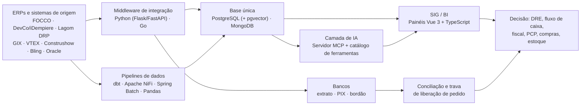
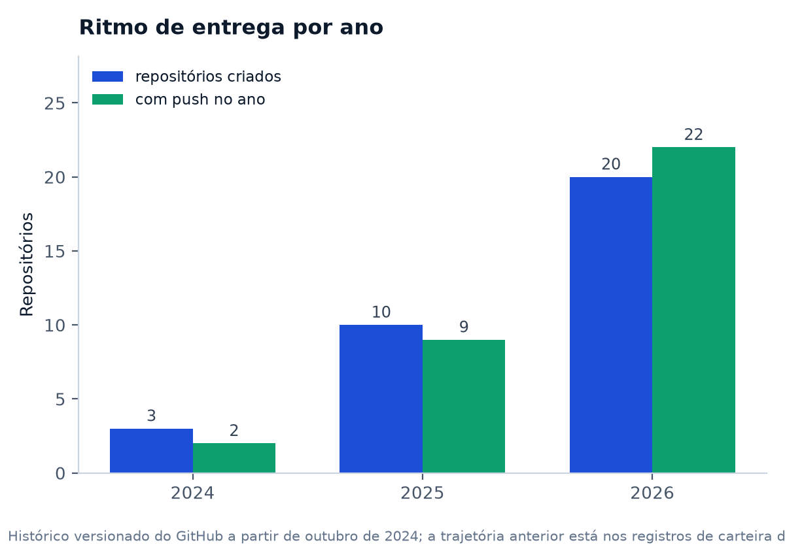

# Daniel Fendrich

**Analista de Sistemas — Integrações ERP, Engenharia de Dados e IA aplicada à gestão**

<p>
  <a href="https://github.com/danielfourmanute"></a>
  
  
  
  
</p>

> **Este repositório é o meu currículo vivo.** Toda afirmação técnica deste documento aponta para um repositório e para o código que o sustenta — quase todo ele em produção, em ambiente de cliente.

📄 **Versão em PDF (2 páginas):** [`Curriculo-Daniel-Fendrich.pdf`](Curriculo-Daniel-Fendrich.pdf) · 📚 **Detalhamento por projeto:** [`PROJETOS.md`](PROJETOS.md)

---

## Resumo

Analista de sistemas com trajetória iniciada em 1994 na área de processamento de dados, programador desde 2001 e analista de desenvolvimento desde 2017. Há mais de 7 anos à frente da **DJT Sistemas**, atendo indústria moveleira, distribuição e varejo material de construção no norte de Santa Catarina, sempre no mesmo eixo: **tirar informação confiável de dentro do ERP e transformá-la em decisão**.

Entrego o percurso completo — extração do ERP, modelagem em PostgreSQL, APIs em Python e Go, interfaces em Vue/TypeScript, observabilidade e, desde 2026, **camada de IA com servidor MCP** para que o cliente consulte o próprio sistema em linguagem natural com guardas de segurança e benchmark de confiabilidade.

| | |
|---|---|
| **Núcleo técnico** | Python (Flask, FastAPI, SQLAlchemy), Go, PostgreSQL, integrações REST com ERPs |
| **Dados** | Modelagem por domínio, dbt, Apache NiFi, Spring Batch, MongoDB, pgvector, Prometheus/Grafana |
| **Interfaces** | Vue 3 + PrimeVue, TypeScript, Fastify, Prisma, Docker Compose |
| **IA aplicada** | Servidor MCP, catálogo semântico de ferramentas, avaliação com dataset, provedores Ollama/OpenAI/Anthropic |
| **Domínio de negócio** | Financeiro (DRE, fluxo de caixa, conciliação bancária), fiscal (NF, NPR, IBS/CBS), PCP, compras, estoque, PDV |


---

## Experiência

### DJT Sistemas — Proprietário e consultor de TI
**08/2019 – em aberto** · São Bento do Sul/SC · *atividade em paralelo ao vínculo CLT*

- Desenvolvimento do **SIG** para a **Móveis Weihermann**: gerenciamento de informações extraídas do ERP (FOCCO), com 473 commits versionados, ~1.200 arquivos Python e 547 scripts SQL.
- Arquitetura **modular por domínio** (financeiro, comercial, compras, estoques, PCP, projetos, cadastros) com `shared_core` de contratos, migrada progressivamente de um monolito de bootstrap sem alterar URLs de produção.
- Middleware de integração reutilizável entre o **DRP Lagom** e os ERPs dos clientes (DevCo/iDempiere, GIX, VTEX, Construshow, Bling, Oracle), com rastreio de retorno, baixa de pedidos e monitoramento de jobs.
- Camada de **IA sobre o ERP**: servidor MCP com catálogo semântico de ferramentas gerado a partir do contrato real, seletor determinístico de capacidades, sanitização de argumentos, guarda de SQL e painel administrativo de telemetria.
- Rotina de entrega com especificação, ADRs, migrations versionadas (Alembic/goose), testes, CI e documentação de implantação e rollback em cada repositório.

### Vieli Consultoria Industrial Ltda — Analista de Desenvolvimento de Sistemas
**11/2017 – em aberto (CLT)** · São Bento do Sul/SC

- Ocupação formal registrada: analista de desenvolvimento de sistemas (CBO 212405), com desenvolvimento e sustentação de sistemas de gestão em ambiente industrial.

### AMC Prestadora de Serviços Ltda — Programador de Computador
**08/2001 – 06/2002** · São Bento do Sul/SC

- Programação de sistemas; primeiro registro formal na função (CBO 8420).

### Início de carreira
**1994 – 1995** · São Bento do Sul/SC

- Operador de máquinas de processamento de dados na Muricy Infor (treinamento, desenvolvimento e assessoria em informática) e rotinas administrativas — primeiro contato profissional com sistema de informação.

---

## Projeto em destaque — SIG (Móveis Weihermann)

Sistema de informações gerenciais que **consolida os dados extraídos do ERP FOCCO em uma base PostgreSQL única** e os devolve como gestão: financeiro, fiscal, comercial, compras, estoque e produção em um só lugar.

| Dimensão | O que o sistema faz |
|---|---|
| **Extração** | Integração FOCCO → PostgreSQL mantida em serviço dedicado em **Go**, com regra de arquitetura que proíbe essa responsabilidade de vazar para Flask/Python |
| **Modelagem** | 51+ tabelas no schema financeiro: títulos a receber/pagar, histórico de movimentações, lançamentos e contas contábeis, estabelecimentos, bancos, agências, clientes, tipos de NF, cidades/UFs/países/idiomas/moedas |
| **Domínios** | `financeiro_app`, `comercial_app`, `compras_app`, `estoques_app`, `pcp_app`, `projetos_app`, `cadastros_app` + `shared_core` |
| **Confiabilidade** | Migrações versionadas, backups de ponto de reset antes de conciliação, normalização de cabeçalhos de planilha e trilha de log de importação |
| **IA** | Benchmarks por modelo e por horário, avaliador com dataset de 50 perguntas e fixtures, recall 39/39 na seleção de ferramentas, decisões seguras (ambígua / somente leitura / sensível / não suportada) antes de chamar o modelo |
| **Produção** | Aplicação em produção documentada, rotação de credencial exposta em histórico, autenticação por Bearer e escopo de empresa por cadeia de vínculo |





---

## Outros projetos que sustentam o currículo

| Projeto | O que resolve | Evidência técnica |
|---|---|---|
| **DataLake com 7 pipelines comparados** | Migração de integração de FOCCO para DevCo com decisão de stack baseada em medição | dbt, Pandas/COPY, MongoDB, Spring Batch (PostgreSQL e MongoDB) e Apache NiFi medidos lado a lado, com Prometheus, Grafana e cAdvisor em Docker Compose |
| **Conciliação bancária executiva** (rede de material de construção) | Conciliar lançamentos de múltiplos bancos com o ERP e **liberar pedido somente após PIX confirmado no extrato** | Go 1.23 (chi, pgx/sqlc, goose, River), PostgreSQL 16 + pgvector, catálogo de conectores bancários em YAML, auditoria com trilha de evidência, MCP com aprovação humana em toda escrita |
| **Middleware padrão VTEX ↔ GIX** | Base única para todas as integrações de um cliente do setor de tintas | Monorepo `uv`, FastAPI, workers de sincronização de catálogo, painel Vue/Sakai, coleção Postman e documentação de pré-requisitos de jobs |
| **Controle de crédito IBS/CBS** (reforma fiscal) | MVP **multi-tenant** de monitoramento de crédito assistido de impostos | FastAPI + SQLAlchemy/Alembic, OIDC com PKCE e Redis, módulo de ingestão, métricas de resiliência de workers |
| **Carga de máquina e PCP** (indústria moveleira) | Lotação do plano mestre e gestão de produção a partir de planilhas e ordens | Importadores de ordens pai/filho, roteiro por máquina e demanda; rede **PERT/CPM**; PostgreSQL com pgvector e Qdrant |
| **Análise de Notas de Produtor Rural** | Apuração fiscal de NPR | API Flask + migrações, front-end com grade de dados |
| **Product matching com embeddings** | Casar produtos e códigos entre sistemas distintos | FastAPI, pgvector, Docker |
| **Integração Roomvo ↔ Oracle** | Projetos de móveis com extração de cor e ambiente de renderização | `oracledb`, túnel SSH, FastAPI, scikit-learn, agendamento |
| **Middleware Lagom DRP ↔ Bling** (público) | Base auditável de integração com ERP de e-commerce | Fastify read-only, contratos de domínio, chave de idempotência, máquina de estados, Prisma + migrations, Vue 3/PrimeVue, escrita desligada por padrão |

---

## Stack com evidência


| Tecnologia | Onde foi usada |
|---|---|
| **Python** (Flask, FastAPI, SQLAlchemy, Pandas) | Núcleo de 25 dos 33 repositórios: SIG, middlewares de integração, painéis e rotinas de importação |
| **Go** | Camada de integração FOCCO → PostgreSQL e a API/worker do sistema de conciliação executiva |
| **PostgreSQL** (+ pgvector, PL/pgSQL) | Base consolidada de todos os sistemas; vetores para matching de produtos e busca semântica |
| **MongoDB** | Armazenamento alternativo nos pipelines de importação medidos no benchmark |
| **dbt · Apache NiFi · Spring Batch** | Pipelines de carga comparados em ambiente observável (Prometheus/Grafana) |
| **Vue 3 · PrimeVue · TypeScript** | Painéis operacionais e console administrativo |
| **Docker Compose · Caddy** | Ambiente de desenvolvimento e implantação em VPS com volumes e redes isoladas por projeto |
| **MCP · Ollama · OpenAI · Anthropic** | Camada de IA consultável sobre o ERP, com catálogo de ferramentas, avaliação e telemetria |
| **Fastify · Prisma · Redis** | Middleware público de integração com Bling e filas/idempotência |
| **Alembic · goose · Flask-Migrate** | Migrações versionadas em todos os projetos em produção |

---

## Portfólio no GitHub

### Público — acesso direto

| Repositório | Descrição |
|---|---|
| [**lagom_bling**](https://github.com/danielfourmanute/lagom_bling) | Middleware entre o DRP Lagom e a API v3 do Bling: Fastify, contratos de domínio, idempotência, máquina de estados, Prisma e Docker |
| [**weihermann-site**](https://github.com/danielfourmanute/weihermann-site) | Repositório de GitHub Pages aberto para o site institucional (ainda só o esqueleto) |
| [Dexo](https://github.com/danielfourmanute/Dexo) · [net-inventory-ia](https://github.com/danielfourmanute/net-inventory-ia) · [usd-brep](https://github.com/danielfourmanute/usd-brep) · [500-AI-Agents-Projects](https://github.com/danielfourmanute/500-AI-Agents-Projects) | Forks de estudo e acompanhamento de tecnologia (Rust, TypeScript, C++, agentes de IA) — não são autoria minha e por isso ficam fora das métricas |

### Projetos de cliente — conteúdo restrito por contrato

Os 31 repositórios privados acima não têm link público. O que cada um faz, o que integra e quais dados controla estão detalhados em [`PROJETOS.md`](PROJETOS.md); **telas e repositórios são apresentados mediante solicitação**.

| Repositório | Domínio | Commits |
|---|---|---|
| `sig` | SIG — indústria moveleira (FOCCO → PostgreSQL) | 473 |
| `revest_middleware` | Middleware DevCo ↔ Lagom ↔ PDV ↔ WMS | 266 |
| `gis-financeiro` | Financeiro: DRE, fluxo de caixa, títulos | 112 |
| `sig-revest` · `revest_sig` · `revest-sig` | Instâncias e nova geração do SIG com DataLake DevCo | 240 |
| `tintasmc` · `lagon_tintasmc` · `*_middleware` | Middleware padrão de integrações VTEX/GIX | 79 |
| `monitor_credito_assistido` | Crédito assistido IBS/CBS multi-tenant | 37 |
| `lagom_*` (acefer, biadola, gasparetto, sotintas, revest, viasoft, fazenda) | Integrações DRP Lagom ↔ ERP de cada cliente | 80 |
| `fazendao-sig` | Conciliação bancária e travas de PIX | 8 |
| `cmaq` · `revest_wms_trial` · `fazendao_roomvo` · `fazendao_integracao` | PCP/carga de máquina, WMS, Roomvo/Oracle, product matching | 35 |
| `enthus_funrural` · `faz_predify` | Fiscal (NPR) e rotinas SQL de vendas | 17 |

---

## Como este currículo é gerado e atualizado

Os números desta página não são declarados, são **coletados**:

```bash
python3 tools/coleta-github.py        # requer gh autenticado
# atualiza dados/github-stats.json, a tabela de projetos e os gráficos de assets/
```

- Metodologia e dados brutos: [`dados/github-stats.json`](dados/github-stats.json)
- Forks são excluídos de todo contagem de repositórios, commits e volume de código.
- Período coberto pela conta: versionado desde out/2024 (o histórico profissional anterior está na carteira de trabalho e nos campos acima).

---

## Formação e contato

**Formação acadêmica e certificações:** a confirmar — envie-me a informação e eu publico aqui nesta seção.

**Contato:** [github.com/danielfourmanute](https://github.com/danielfourmanute) → *Issues ou mensagem direta no GitHub*. Para e-mail e telefone, [abra uma issue no repositório](https://github.com/danielfourmanute/cv/issues/new) que eu respondo com os dados de contato direto.

📍 São Bento do Sul/SC — atendimento presencial na região e remoto para todo o Brasil.

---

<sub>Dados gerados a partir da conta GitHub em 20/11/2026 · Experiência profissional conforme registro de carteira de trabalho (CTPS) · CPF, remuneração e demais dados pessoais foram intencionalmente omitidos.</sub>
